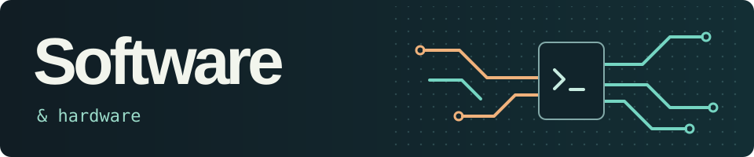

I'm João. I like figuring out what happens between pressing a button and getting a result. That curiosity takes me from C and Linux to the inside of phones and PCs. I learn by getting my hands on something, making a prediction and seeing whether it holds up.

## What I’m comfortable with

| Area | What I can do |
| --- | --- |
| **C** | Read and write C, follow pointers and trace the lifetime of an allocation when a program behaves unexpectedly. |
| **Linux & Python** | Work from the terminal, narrow down a failing command and write small scripts to take repetitive work off my hands. |
| **PCs & phones** | Take devices apart, keep track of components during reassembly and test the specific function that was failing. |
| **Troubleshooting** | Turn “sometimes it breaks” into a repeatable set of steps and explain what I observed clearly enough for someone else to check. |

## How I think

Intermittent faults are the ones that hold my attention. If a phone only charges at a particular angle, I want to know whether the behaviour follows the cable or stays with the device. I use the same habit in software: keep the environment steady, change one input and watch where the result first diverges from what I expected.

I like swapping notes with people who approach the same problem differently. A command I hadn't thought to try, or a question about something I took for granted, can save an afternoon of chasing the wrong cause.

## What I’m curious about

- **Systems programming** — how a shell starts a process and what happens to memory while a C program runs.
- **Hardware diagnostics** — how to tell whether a symptom comes from a physical component, a driver or a setting.
- **Testing everyday software** — why a feature works on one machine and fails on another, and how to capture the difference in a useful bug report.
