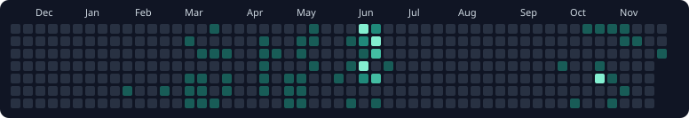

## GitHub activity

## BlindTest · Name that track

A song clip starts. Everyone in the room races to guess the artist and title, and the scoreboard updates as guesses come in. I built BlindTest for the browser and for friends playing together in a Discord voice channel.

**Inside the build** · Next.js and TypeScript handle the game interface. The Socket.IO server keeps rooms and scores in sync. A separate worker tags tracks by genre so players can choose what goes into a round.

[Explore BlindTest →](https://github.com/jmal423/blindtest)　·　[Read the server code](https://github.com/jmal423/blindtest/tree/HEAD/backend)

## Valgrind42 · Find the missing free

I built a Linux tool for a question that comes up in 42 C exercises: *what did my program allocate and forget to free?* It tracks heap allocations and prints a summary when the process exits.

~~~text
in use at exit: 4 bytes in 1 blocks
total heap usage: 1 allocs, 0 frees, 4 bytes allocated
~~~

[Explore Valgrind42 →](https://github.com/jmal423/valgrind42)　·　[Read the allocation hook](https://github.com/jmal423/valgrind42/blob/HEAD/src/valgrind_hook.c)

